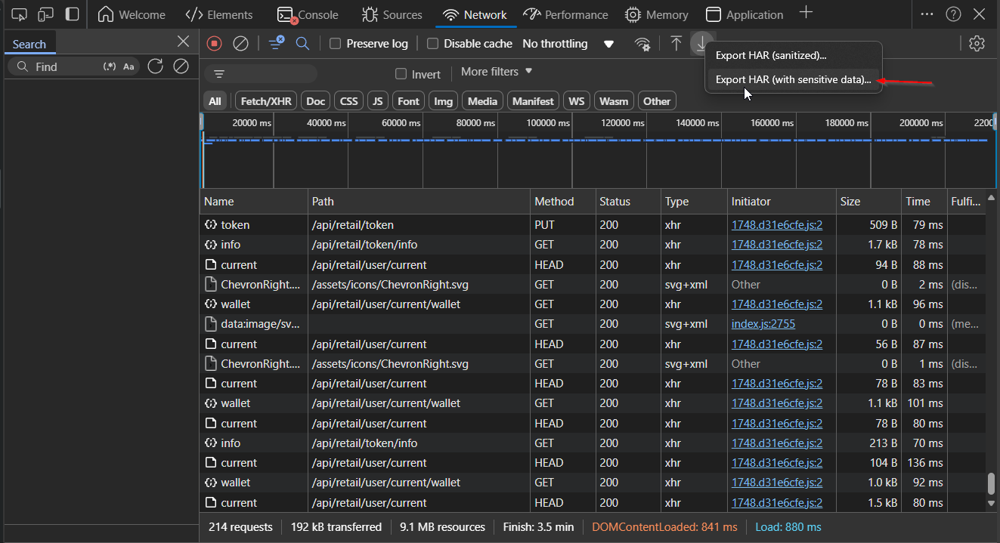
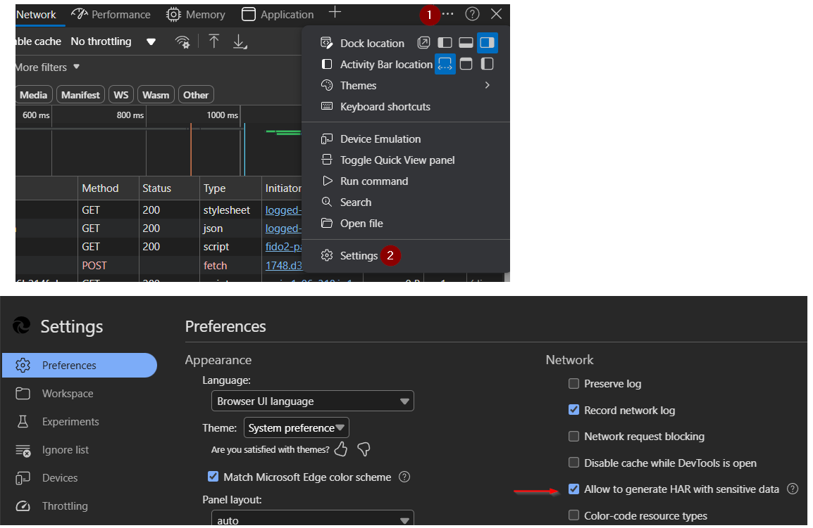

### RevolVer

Revolut doesn't provide an option to export transactions with custom categories directly. This script replicates the HTTP requests made by the Revolut web application to retrieve transaction data, and export it to SQLite and/or Excel file.

### Installation

1. Clone this project  
2. Install required packages  
`pip install -r .\requirements.txt`

### Requirements
Before each usage, authentication data must be provided. The script supports two methods:

#### Method 1: Copy as cURL (Recommended)
1. Go to https://app.revolut.com and login.
2. Open developer tools by pressing F12.
3. Click on "See all" transactions:  


4. In the Network tab, find the request to `transactions/last` endpoint, right-click it and select "Copy > Copy as cURL (bash)" or "Copy as cURL (cmd)":  
5. Paste the copied curl command into `curlcmd.txt` file in the root directory.
6. Proceed by running the script right away as the authentication data tend to expire fast.

#### Method 2: HAR file (Legacy)
Alternatively, you can export a HAR file from Revolut web application and save it to `consume/` directory as `app.revolut.com.har`. The script will automatically detect and use it if `curlcmd.txt` is not present.

1. Go to https://app.revolut.com and login.
2. Open developer tools by pressing F12.   
3. Click on "See all" transactions:  


4. In developer tools, go to Network tab and export HAR:  


** NOTE: As of 30 September 2024, Chromium-based browsers (Chrome, Edge, etc) [by default will not include all required headers when exporting HAR file](https://developer.chrome.com/blog/new-in-devtools-130). If you don't see option "Export HAR (with sensitive data)", make sure to enable it in settings else the script will fail with `ERROR - Could not find authentication data from HAR file` **  

4.a. Enable "Export HAR (with sensitive data)" in Edge (it's similar with other Chromium-based browsers as well):  


Now you can long-press Download button to reveal option "Export HAR (with sensitive data)"  

5. Save the file "app.revolut.com.har" to `consume/` directory. Do not change the filename.  
6. Proceed by running the script right away as the authentication data tend to expire fast.  

### Usage

At minimum, only `--date` must be provided to fetch results for single month and save them to both SQLite and Excel file:  
`python revol_ver.py -d 2024.4`  

For initial export, you may want to export all records. Set `--period` to `all`. Also make sure to edit setting `AllImportLookBackYears` in config.ini to desired export period.  
`python revol_ver.py -p all`  

By default, it will save the transactions to SQLite database with filename `trans_db.sql` and Excel file to `exports/` directory. Change this by setting `--output` to either `db` or `excel`.  
`python revol_ver.py -p all -o excel` 

Once database is created, it will also be used for deduplication. It can be turned off with `-dd` flag, but only when output is set to `excel`.

Other command line arguments are mostly used for testing purposes. Use `--help` see all options:  

    python revol_ver.py -h
    usage: revol_ver.py [-h] [-p {month,all}] [-s {web_request,file}] [-d DATE] [-o {db,excel,all}] [-dd]

    Saves transactions from Revolut to database or Excel

    options:
      -h, --help            show this help message and exit
      -p {month,all}, --period {month,all}
      -s {web_request,file}, --source {web_request,file}
      -d DATE, --date DATE  Month and year (YYYY.MM), required for period "month"
      -o {db,excel,all}, --output {db,excel,all}
                            Output destinations
      -dd, --dont_deduplicate
                            Don't use database for deduplication


### Common errors

1. **curl command or HAR file not found**  
`FileNotFoundError: [Errno 2] No such file or directory: 'curlcmd.txt'`  
or  
`FileNotFoundError: [Errno 2] No such file or directory: 'consume\\app.revolut.com.har'`

    Reason and fix: The script needs authentication data. Either:
    - Create `curlcmd.txt` in the root directory and paste a curl command (copied from browser DevTools), OR
    - Export HAR file to `consume/app.revolut.com.har`
  
2. **Token expired**  

    ```
    Exception: Fetching failed, got response  
    {'message': 'Access token expired', 'code': 9039}  
    ```

    Reason and fix: Authentication data has expired. Copy a fresh curl command or export a new HAR file and try again.  

3. **Custom category not defined**

    A transaction with a custom category whose UUID is not in `config.ini` no longer stops the export. It is saved with a placeholder category `custom_<first 8 characters of the UUID>`, and a warning names the UUID. To show your own name instead, add the UUID to the `custom.categories` section of `config.ini` and export again:

    ```
    [custom.categories]
    aead2528-4b7b-481d-bc1f-0f27ec4b3926 = home_improvements
    ```

    With custom categories configured, the script will use this mapping to transform the UUID returned by Revolut to defined category name which is visible in column `category` in both database table and Excel.